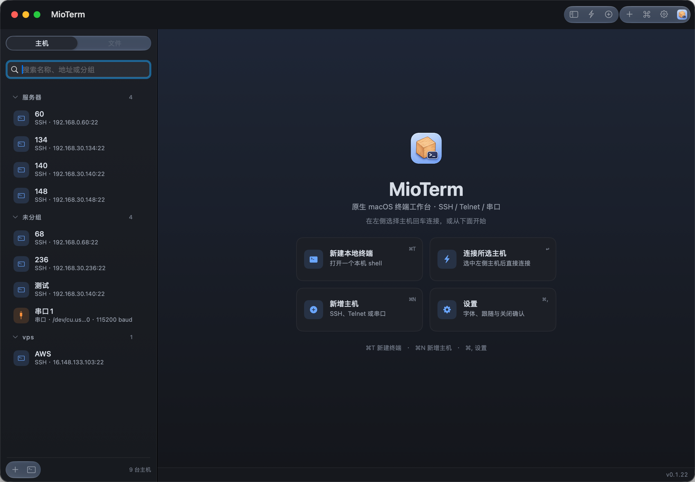
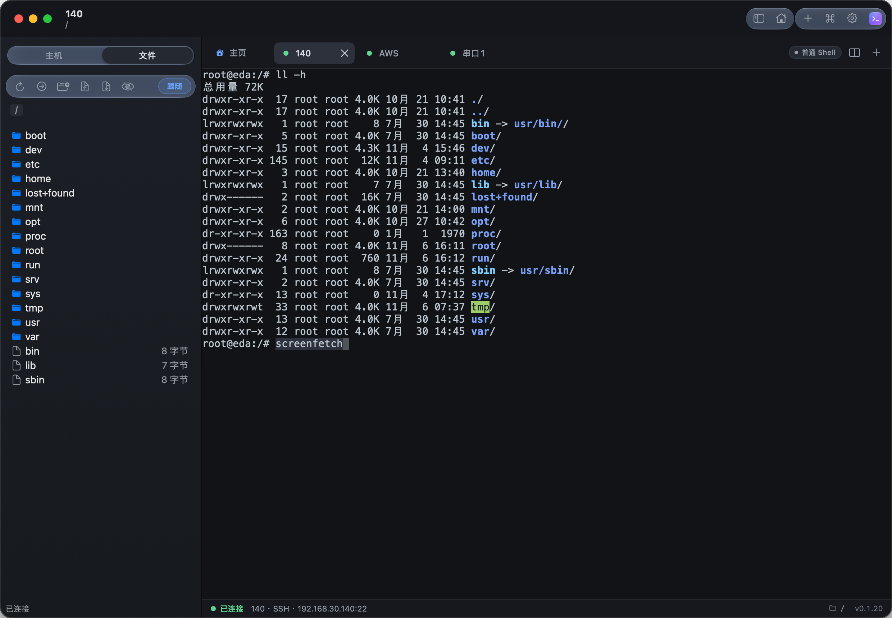

# MioTerm

**English** | [中文](../README.md)

**A lightweight, native terminal workspace for macOS.**

Local shells, remote connections, device debugging and file management in one clean window.

## What you need before using it

### System requirements

- **macOS 14 Sonoma or later.**
- **A Mac matching the release package**: pick `arm64` for Apple Silicon (M-series chips), `x86_64` (x64) for Intel processors.

### Per-feature prerequisites

Get a Mac and a MioTerm release package that meet the system requirements, then prepare the following for the features you plan to use:

| Feature | Requirements |
| --- | --- |
| Local terminal | A working shell on this Mac. The app reads the `SHELL` environment variable and falls back to macOS's built-in `/bin/zsh`. |
| SSH connections | macOS's built-in `/usr/bin/ssh`, `/usr/bin/ssh-keyscan` and `/usr/bin/ssh-keygen`; the target host's address, SSH port and login credentials, plus network access to that port. |
| SFTP file management | The system OpenSSH on this Mac, and an SSH server on the remote side with the SFTP subsystem enabled. |
| Private-key login | The login account and its private key file; when using ssh-agent authentication, add the key to the local agent first. |
| Telnet connections | The target device's address, its Telnet service port, and network access to that port. |
| Serial terminal | A serial device or USB-to-serial adapter, plus the macOS driver the device requires. Once connected, the system should expose a `/dev/cu.*` or `/dev/tty.*` device. |
| X11 forwarding | [XQuartz](https://www.xquartz.org/) installed and running on this Mac, `/opt/X11/bin/xauth`, a valid `DISPLAY` environment variable, and a remote SSH server that allows X11 forwarding. |

### Installation and first launch

1. Unzip the release package and drag `MioTerm.app` into the Applications folder.
2. Open the app. Release packages are ad-hoc signed, so on first launch follow the macOS security prompt to allow it — choose "Open Anyway" under System Settings → Privacy & Security.
3. The first time credentials are saved or read, approve the Keychain access prompt if macOS shows one.

## Screenshots

## Features

### Multiple connection types

- **Local shell**: open a command line on this Mac directly.
- **SSH**: password, private key and ssh-agent authentication; configurable port, starting directory, connect timeout and keepalive.
- **Telnet**: for remote consoles and network equipment.
- **Serial terminal**: device selection, baud rate, data bits, stop bits, parity, newline handling, local echo and BREAK.
- **X11 forwarding**: SSH sessions can opt into untrusted or trusted forwarding; requires a local X11 service.

### Host management

Organize frequently used hosts into groups, with search, favorites, configuration duplication and connection tests. Host passwords and private-key passphrases are stored in the macOS Keychain. First-time SSH connections ask you to confirm the host fingerprint, and you get a warning when a server key changes.

### Tabs and side-by-side splits

- Keep several terminals open at once; drag tabs to reorder them.
- Pair any two open sessions into a split while keeping both connections and their output history.
- While splitting, you can also open a new remote connection or explicitly start a new local terminal.
- Drag the middle divider to resize the two sides; click a pane to make it the active terminal.
- Leaving a split keeps the sessions alive; closing one side lets the other fill the window.
- Drag a tab onto another terminal's page to split the two instantly.

### SFTP file management

When creating or editing an SSH host, the "Connect SFTP" option (连接 SFTP) decides whether file management is enabled; unchecked, the session opens a terminal only — no SFTP channel and no file tree.

SSH sessions get a dedicated file panel with directory browsing, hidden-file display, upload, download, mkdir, rename and delete. Drag files in from Finder to upload, and use the transfer queue to watch progress, pause, resume or cancel jobs.

The file panel can follow the terminal's current directory, making it easy to switch between command-line work and browsing. Directory following relies on OSC 7 and recognizable shell prompts; it pauses inside nested SSH sessions or containers so paths from different environments never get mixed up.

### Appearance and color themes

Open the palette editor from **View → Page Style…** (显示 → 页面样式…):

- Four presets: Default, Deep Sea Blue, Pine Green and Warm Paper.
- Configure the overall background, sidebar, tab bar, panels, UI text, accent color and selected-tab background individually.
- Configure terminal background, text, selection and cursor colors, plus the terminal font and size.
- Dark and light mode are stored separately; color picker and hex input are both supported.
- Live preview; clicking "Apply" updates existing windows and terminals immediately.
- Restore defaults, or import/export MioTerm JSON palette files.

### Command library

Records frequently used commands per host or per local terminal, sortable by usage count and last-run time, with favorites and ignore rules — handy for repeating everyday operations.

### Lightweight by design

A native macOS interface that keeps everyday resource usage in mind. New configurations keep 2000 lines of scrollback per terminal by default; the setting can be changed and takes effect immediately, while existing configurations keep their current value. Style previews are drawn natively.

## Quick start

1. Open the app and create an SSH, Telnet or serial configuration in the host list, or start a local terminal right away.
2. Once connected, switch sessions with the tabs at the top and drag tabs to reorder them.
3. To pair two sessions, select one terminal, then right-click the other tab and choose "Split side-by-side with the current terminal" (与当前终端左右分屏); the split button also lets you pick a session or a host.
4. In an SSH session, open the remote file panel to browse directories and transfer files.
5. Adjust scrollback, fonts and connection defaults in Settings, and customize colors under Page Style.

## Keyboard shortcuts

| Shortcut | Action |
| --- | --- |
| `⌘T` | New local terminal tab |
| `⌘W` | Close the current terminal session |
| `⌘R` | Reconnect a finished session |
| `⌘⇧D` | Choose or configure a side-by-side split |
| `⌘1`–`⌘9` | Jump to the corresponding session tab |
| `⌘[` / `⌘]` | Previous / next tab |
| `⌘⌥F` | Open the remote file panel |
| `⌘K` | Open the command library |
| `⌘,` | Open Settings |

## Feedback

Issues and feature suggestions are welcome. When reporting a problem, please include your macOS version, the connection type, reproduction steps and screenshots where useful; strip sensitive information before attaching logs.

## License

This project is licensed under the [Apache License 2.0](../LICENSE).