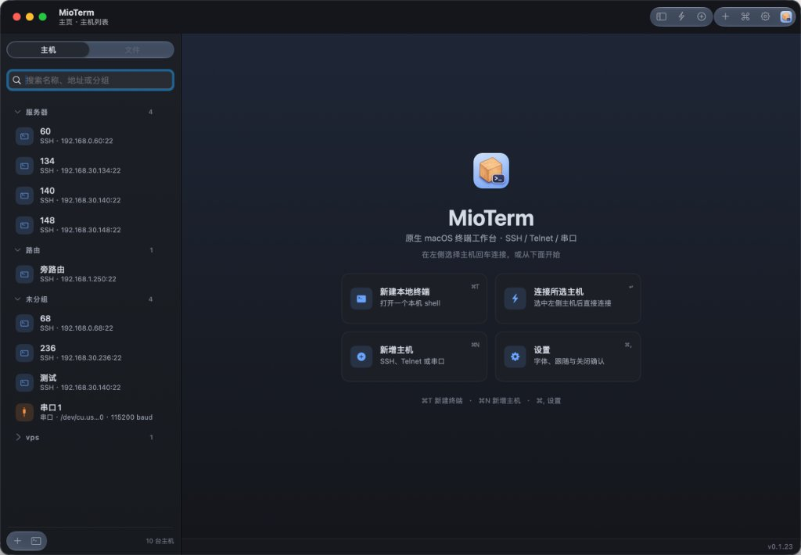
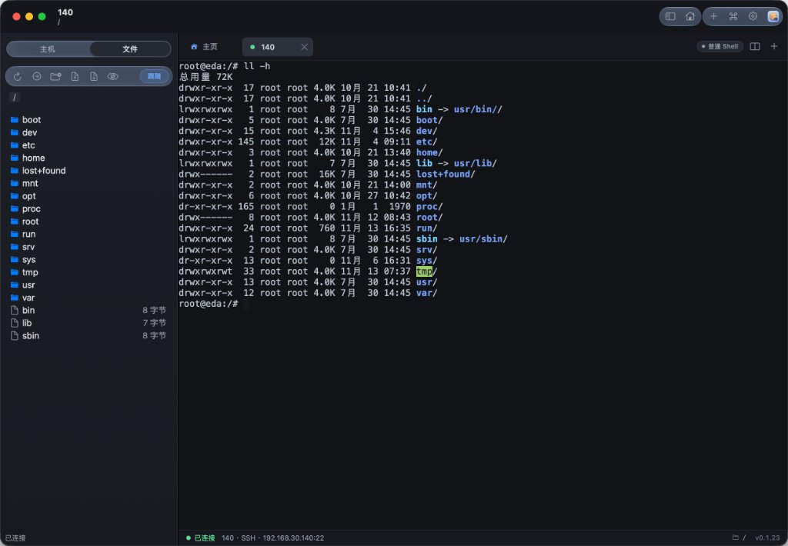

# MioTerm

[English](.github/README.md) | **中文**

**面向 macOS 的轻量原生终端工具。**

把本地命令行、远程连接、设备调试和文件管理放进一个简洁的窗口。

## 使用前需要准备什么

### 系统要求

- **macOS 14 Sonoma 或更新版本**。
- **与发行包匹配的 Mac**：Apple Silicon（M 系列芯片）选择 `arm64`，Intel 处理器选择 `x86_64`（x64）。

### 各功能的使用条件

准备符合系统要求的 Mac 和 MioTerm 发行包，再根据使用的功能准备以下环境：

| 使用功能 | 使用条件 |
| --- | --- |
| 本地终端 | 本机可用的 Shell。应用读取 `SHELL` 环境变量，默认使用 macOS 自带的 `/bin/zsh`。 |
| SSH 连接 | macOS 自带的 `/usr/bin/ssh`、`/usr/bin/ssh-keyscan` 和 `/usr/bin/ssh-keygen`；目标主机的地址、SSH 端口和登录凭据，以及可访问目标端口的网络。 |
| SFTP 文件管理 | 本机系统 OpenSSH，以及远端 SSH 服务中已启用的 SFTP 子系统。 |
| 私钥登录 | 登录账号与对应的私钥文件；使用 ssh-agent 认证时，先将密钥加入本机 agent。 |
| Telnet 连接 | 目标设备的地址、Telnet 服务端口，以及可访问该端口的网络。 |
| 串口终端 | 串口设备或 USB 转串口适配器，以及设备要求的 macOS 驱动。连接后，系统应能识别 `/dev/cu.*` 或 `/dev/tty.*` 设备。 |
| X11 图形转发 | 本机已安装并启动的 [XQuartz](https://www.xquartz.org/)、`/opt/X11/bin/xauth` 和有效的 `DISPLAY` 环境变量，以及允许 X11 转发的远端 SSH 服务。 |

### 安装与首次打开

1. 解压发行包，把 `MioTerm.app` 拖入“应用程序”文件夹。
2. 打开应用。当前发行包采用临时签名，首次打开请按 macOS 安全提示授权运行，可在“系统设置 → 隐私与安全性”中选择“仍要打开”。
3. 首次保存或读取登录凭据时，如果系统询问钥匙串访问权限，按提示授权。

## 界面预览

## 主要功能

### 多种连接方式

- **本地 Shell**：直接打开本机命令行。
- **SSH**：支持密码、私钥和 ssh-agent 等认证方式，可配置端口、起始目录、连接超时与保活。
- **Telnet**：用于远程控制台与网络设备连接。
- **串口终端**：支持设备选择、波特率、数据位、停止位、校验、换行方式、本地回显和 BREAK。
- **X11 转发**：SSH 会话可选择受限或可信转发，需要本机提供 X11 服务。

### 主机管理

按分组管理常用主机，支持搜索、收藏、复制配置和连接测试。主机密码与私钥口令使用 macOS 钥匙串保存；SSH 首次连接提供指纹确认，服务器密钥变化时给出提示。

### 多标签与左右分屏

- 同时打开多个终端，拖动标签即可调整顺序。
- 选择任意两个已打开的会话组合分屏，保留原有连接和输出历史。
- 分屏时也可以新建远程连接，或明确选择新建本地终端。
- 拖动中间分隔带调整两侧宽度，点击窗格切换当前终端。
- 直接把标签拖到另一个终端的画面上，即可将两个会话分屏。
- 退出分屏保留会话，关闭一侧后另一侧自动铺满。

### SFTP 文件管理

创建或编辑 SSH 主机时，可通过“连接 SFTP”选择是否启用文件管理；取消勾选后仅连接终端，不建立 SFTP 通道，也不显示文件树。

SSH 会话内提供独立的文件面板，支持目录浏览、隐藏文件显示、上传、下载、新建目录、重命名和删除。可从 Finder 拖入文件上传，并通过传输队列查看进度、暂停、继续或取消任务。

文件面板支持跟随终端当前目录，方便在命令行操作与文件浏览之间切换。目录跟随依据 OSC 7 和可识别的 Shell 提示符；进入嵌套 SSH 或容器环境时会暂停，避免混淆不同环境的文件路径。

### 页面样式与配色

从 **“显示 → 页面样式…”** 打开配色编辑器：

- 提供默认、深海蓝、松林绿、暖纸色四套预设。
- 单独配置整体背景、侧栏、标签栏、面板、界面文字、强调色和选中标签背景。
- 配置终端背景、文字、文字选区与光标颜色，以及终端字体和字号。
- 深色与浅色模式分别保存，支持取色器和十六进制颜色输入。
- 实时预览，点击“应用”即可更新已有界面和终端。
- 支持恢复默认配色，以及 MioTerm JSON 配色文件的导入、导出。

### 常用命令库

按主机或本地终端分别记录常用命令，支持使用次数与最近执行时间排序、收藏及忽略规则，便于重复执行日常操作。

### 轻量设计

采用原生 macOS 界面，注重日常使用中的资源占用。新配置默认保留每个终端 2000 行回滚历史，可在设置中调整并立即生效；已有配置保留原值。样式预览通过原生绘制提供。

## 快速使用

1. 打开应用，在主机列表中新建 SSH、Telnet 或串口配置，也可以直接新建本地终端。
2. 连接后，通过顶部标签切换会话，拖动标签调整顺序。
3. 要组合两个会话，先选中一个终端，再右键另一个标签，选择“与当前终端左右分屏”；也可以点击分屏按钮选择会话或主机。
4. SSH 会话中可打开远端文件面板，浏览目录、传输文件。
5. 在设置中调整回滚历史、字体和连接默认值，在“页面样式”中定制配色。

## 常用快捷键

| 快捷键 | 功能 |
| --- | --- |
| `⌘T` | 新建本地终端标签 |
| `⌘W` | 关闭当前终端会话 |
| `⌘R` | 重新连接已结束的会话 |
| `⌘⇧D` | 选择或配置左右分屏 |
| `⌘1`～`⌘9` | 切换到对应会话标签 |
| `⌘[` / `⌘]` | 上一个 / 下一个标签 |
| `⌘⌥F` | 打开远端文件面板 |
| `⌘K` | 打开命令库 |
| `⌘,` | 打开设置 |

## 使用反馈

欢迎通过 Issue 反馈问题或提出功能建议。反馈问题时，请尽量附上 macOS 版本、连接类型、复现步骤和必要的截图；提供日志前请移除敏感信息。

## 许可证

本项目采用 [Apache License 2.0](LICENSE)。
